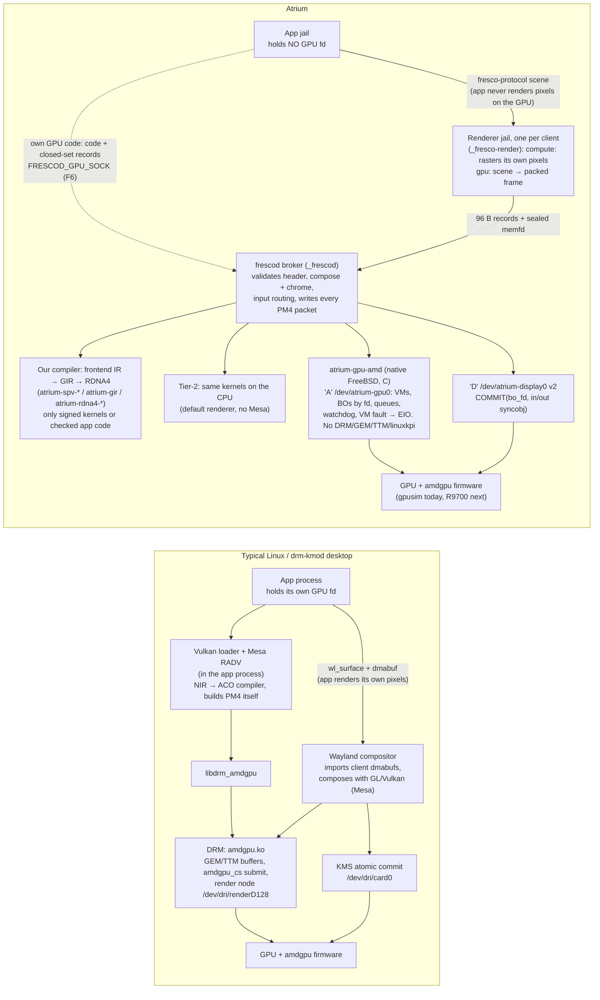
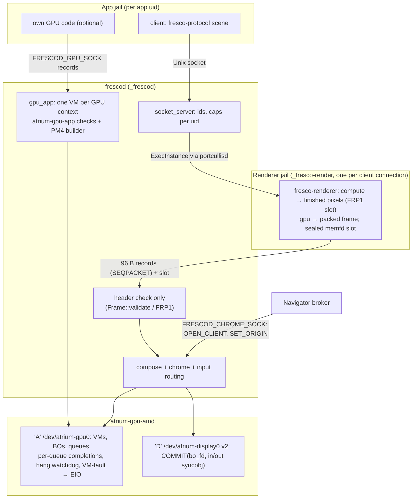

# The Atrium graphics stack

> **What this is.** A map of the graphics stack as the code stands now:
> kernel driver, the ABIs above it, the compositor and its renderers, how a
> 2D app, an app with its own GPU code and a third-party Vulkan app each
> reach the screen, and what is still missing. Written from the code first;
> where a spec disagrees, the code wins here and §11 says so. Kept current
> with the code (last updated 2026-11-05); workstream progress is in
> [STATUS.md](STATUS.md).
>
> Specs that remain the reference for intent: [spec/atrium-gpu-abi-v2.md](spec/atrium-gpu-abi-v2.md)
> (header `include/atrium/gpu_abi_v2.h` is normative), `include/atrium/display_abi_v2.h`,
> [spec/fresco-f4-split.md](spec/fresco-f4-split.md), [spec/gpu-app-path-f6.md](spec/gpu-app-path-f6.md),
> [spec/atrium-navigator-threat-model.md §2.5](spec/atrium-navigator-threat-model.md),
> [spec/atrium-rdna4-vulkan-backend.md](spec/atrium-rdna4-vulkan-backend.md), [spec/atrium-gpu-ir.md](spec/atrium-gpu-ir.md),
> [spec/aqueduct-gpu.md](spec/aqueduct-gpu.md), [spec/tier2-renderer.md](spec/tier2-renderer.md),
> [reviews/2026-11-04-fresco-display-pipeline.md](reviews/2026-11-04-fresco-display-pipeline.md).

## 1. Summary

- **Apps never touch the GPU.** A 2D app sends a retained, content-addressed
  scenegraph (`fresco-protocol`, the `CLASS_DISPLAY` vocabulary on the
  Aqueduct envelope) to **frescod** over a Unix socket. frescod owns all GPU
  and display resources. An app with its own GPU code sends checked code and
  closed-set records over frescod's GPU channel (F6); it still holds no GPU fd.
- **frescod renders with its own compute kernels, not Vulkan.** `fresco-compute`'s
  bin, raster and compose kernels run on the **CPU through Tier-2** (the
  default, `FRESCOD_RENDERER=compute`) or on the **GPU through our RDNA4
  compiler** (`FRESCOD_RENDERER=gpu`). Each client's scene is packed by its
  own jailed renderer process. The old Vulkan renderer
  (`fresco-vulkan::HeadlessRenderer`) is **deprecated**: opt-in only with
  `FRESCOD_RENDERER=vulkan`, and split mode is off with it.
- **The kernel side is Atrium's own** (no DRM, no linuxkpi, no drm-kmod).
  The canonical driver is **`atrium-gpu-amd`**, a from-scratch RDNA4 driver
  that today runs against **gpusim**, a functional RDNA model in a separate
  repo, wired into QEMU as a PCI device. It exposes the v2 GPU ABI (`'A'`,
  `/dev/atrium-gpu0`) and display ABI v2 (`'D'`, `/dev/atrium-display0`:
  commit a BO fd with in/out fences, paced by flip-done).
- **Mesa is not used at runtime on the default path.** lavapipe runs only if
  someone opts into `FRESCOD_RENDERER=vulkan`, and as the golden-test oracle
  for `fresco-compute`. RADV is used only on the R9700 box as the speed
  yardstick for our compiler.
- **3D and third-party Vulkan go through a separate GPU-dispatch protocol,
  `aqueduct-gpu`.** `atrium-vk-icd` turns Vulkan calls into `FrameOp`s and
  sends them to an `aqueduct-gpu-host` endpoint. That endpoint runs Tier-1
  (tiny-skia), Tier-2 (Atrium's own AOT SPIR-V→native CPU compiler,
  `atrium-spv-*`) or Tier-3 (MoltenVK→Metal on the Mac host, reached from the
  VM through the **Carillon** doorbell transport). The finished frames come
  back into frescod as textures. A native Vulkan driver on our RDNA4
  backend is the next step for this path.

## 2. Side by side: a typical Linux desktop vs Atrium

The left column is the stack a Linux desktop on an AMD GPU uses today
(Wayland compositor, Mesa RADV, libdrm, the DRM `amdgpu` driver). FreeBSD
gets the same stack by porting it: drm-kmod runs the Linux driver through
linuxkpi. The right column is Atrium. Every box on the right is our own code
except the device itself and AMD's firmware blobs, which load unmodified
(binary redistribution only, see `graphics/rdna4/LICENSE.amdgpu.txt`).



| Layer | Typical Linux desktop | Atrium | Why ours differs |
|---|---|---|---|
| What an app sends | pixels it rendered itself (dmabuf), plus GPU work it submits directly | a retained scene (`fresco-protocol`); GPU work only as checked code + closed-set records through frescod | apps hold no GPU fd in production (GPU ABI v2.1); a hostile page cannot reach the driver |
| Who renders an app's window | the app, with its own Vulkan/GL driver | a per-client jailed renderer, running our kernels: on the CPU it rasters the window itself (default); on the GPU frescod rasters it in that window's own GPU VM | the renderer is sacrificial; frescod trusts only a header and composes |
| Userspace driver | Mesa RADV (Vulkan), radeonsi (GL), inside every app | none in apps. frescod runs our compiler's output; third-party Vulkan goes through `atrium-vk-icd` → aqueduct-gpu → Tier-2/Tier-3 | no driver code in untrusted processes; one compiler we control |
| Shader compiler | NIR → ACO (or LLVM), in the app process | frontend IR → GIR → RDNA4 machine layer, built from AMD's public ISA docs only | public-sources rule; layered for more GPU families; RADV kept only as the speed yardstick on the R9700 |
| CPU fallback | lavapipe/llvmpipe (Mesa) | Tier-2: AOT SPIR-V → native code (bespoke ARM64 and x86_64, Cranelift fallback); it is frescod's default renderer | no Mesa at runtime; lavapipe survives only as a golden-test oracle and `FRESCOD_RENDERER=vulkan` |
| Command submission | userspace builds IBs; kernel `amdgpu_cs` checks BOs, not packets | the broker (`atrium-gpu-app`, frescod) writes every packet; the ring is read-only to the GPU; app code is mapped read-only and confined by its VMID | packets come from one trusted writer |
| Buffers | GEM handles, TTM placement, dmabuf export | BOs named by fd; sealed buffers for content-addressed sharing (GPU ABI v2.1 §5.13) | fds pass like any capability; no global GEM names |
| Kernel driver | DRM `amdgpu.ko` (Linux), or drm-kmod via linuxkpi on FreeBSD | `atrium-gpu-amd`, written for FreeBSD from scratch (newbus, bus_dma, kqueue) | no DRM, no linuxkpi; per-VM isolation, watchdog and fault handling designed in |
| Display | KMS atomic commit on the card node | display ABI v2: commit a BO fd with in/out syncobj fences, exclusive node, flip-done pacing | smaller surface; only frescod opens it |
| Compositor | Wayland compositor (Mutter, KWin, …) compositing client buffers | frescod: compose kernel over a layer list it owns, plus a trusted chrome strip no app can draw | origin indicator and input routing cannot be spoofed by a window |
| Isolation unit | process + render node permissions | jail per app, jail per renderer, GPU VM per context | matches Portcullis's one-jail-per-app model |
| Test target | the real GPU | gpusim (our clean-room RDNA4 model in QEMU), checked against the R9700 by the oracle corpus (v19: 54/54) | develop without the card; silicon decides |

The thing to take away: on Linux the GPU driver, its compiler and the
right to submit work all live **inside each app**. In Atrium they live in
**one trusted broker**, and apps send either a scene or checked code.

## 3. Processes and trust



| Piece | What it does | Code | Landed |
|---|---|---|---|
| Display ABI v2 | `COMMIT` names a BO by fd, waits on an in-syncobj, signals an out-syncobj when on screen and the old buffer is free; exclusive node; last frame held across close; a second outstanding commit is EBUSY. Retires `SET_MODE`/`PAGE_FLIP`/`BO_EXPORT_SCANOUT`. frescod double-buffers and is paced by flip-done (the 30 fps timer is gone) | `include/atrium/display_abi_v2.h`, `atrium-gpu-amd/display/` | `b3d298e`, `4205742` |
| Compute renderer | `bin.comp` + `raster.comp` over storage buffers, a Rust reference that matches statement for statement, lavapipe golden | `fresco-compute/` | `ce1d804`, `6ca05f0` |
| `FRESCOD_RENDERER=compute` | **the default.** Kernels compiled in-process by Tier-2 (Cranelift is a default feature) | `frescod` | `1455488` |
| `FRESCOD_RENDERER=gpu` | same kernels on the GPU. Arch-neutral behind `fresco_compute::gpu::{Arch, Stream}`; RDNA4 is one `Arch`. Picked from the driver's `CAP_ISA` (or `FRESCOD_GPU_ARCH`). Damage tracking rasters only changed tiles | `fresco-compute/src/gpu`, `rdna4` | `7c1ec1b`, `57035bc`, `1455488`, `da65060` |
| `FRESCOD_RENDERER=vulkan` | the old `HeadlessRenderer` path (lavapipe in the VM); opt-in; split mode stays off with it | `fresco-vulkan` | — |
| Bounds (F2) | broker checks only the header; kernels bound every index read from content and are NaN-safe; differential fuzzer (Tier-2, GIR, gpusim) | `fresco-compute/tests/fuzz.rs` | `9323062` |
| Per-window surfaces + compose (F4a) | one surface per window; fixed compose kernel over the broker's layer list | `fresco-compute`, `frescod` | `a20492f`, `797a3e5` |
| Process split (F4b) | one renderer per client connection; records over SEQPACKET, memfd slots sealed against resize. **On by default** with compute/gpu (`FRESCOD_SPLIT=0` turns it off). frescod sends `ExecInstance` to portcullisd itself and fails closed (no portcullisd → client refused). Renderer runs as `_fresco-render` (65011), frescod as `_frescod` (65010); 512 MiB / 100 % CPU caps; fonts in the bundle (`scripts/fresco-renderer-bundle.sh`). portcullisd kills a worker whose caller hangs up | `fresco-split/`, `frescod`, `portcullis` | `a46ec90`, `0a864bd`, `a43f23f`, `3754439`, `3ccac5d` |
| Input routing (F4c, F4c′) | pointer hits the layers last composed; window 0 is the WM's; clicks pass through pixels with alpha < 16 | `frescod` | `1c87e2d`, `2cf9231` |
| Trusted chrome (F4d) | 24 px top strip only frescod draws (built-in font, origin charset only), focus ring; origin set over the chrome socket, never by the renderer. `DISPLAY_INFO.reserved_top` tells forum-wm to lay out below it | `frescod`, `forum-wm` | `a9bf150`, `11984d2` |
| Broker fuzzing (F3) | `atrium-split-fuzz` plays hostile renderers and a hostile Navigator; broker sends non-blocking and retires a renderer whose channel is full; per-renderer rate budgets | `atrium-split-fuzz`, `scripts/fresco-split-fuzz.sh` | `9d8429a` |
| Connection limits | 32 connections per uid; last 64 client ids at most 2 per uid | `fresco-scene-server` | `a43f23f`, `da65060` |
| App GPU channel (F6) | `FRESCOD_GPU_SOCK`, one GPU context (thread + VM) per connection, ≤ 4 per uid, last 8 of 32 one per uid. Apps send a code header + machine code + closed-set records (bind code, user SGPRs, dispatch, barrier); `atrium-gpu-app` checks every field and writes every PM4 packet; the ring is read-only to the GPU; code mapped read-only. **Option A:** app code is untrusted, the VMID confines it. Hostile ISA (infinite loop, wild stores) is lost with EIO while other apps' work completes | `atrium-gpu-app/`, `frescod/src/gpu_app.rs`, `atrium-gpu-fuzz` | `6dcd221`, `4cf6395`, `a8a595d`, `5f6bd11`, `a8587af`; spec [spec/gpu-app-path-f6.md](spec/gpu-app-path-f6.md) |
| One GPU VM per window (F4e) | with `FRESCOD_RENDERER=gpu`, each window's bin and raster run in their own VM (code and staging read-only, its own inputs, ring and surface); compose runs in frescod's VM, which maps every surface read-only plus the scanout. `FRESCOD_GPU_ISOLATION_PROBE=1` makes later windows write the first window's surface: both writes fault (EIO) | `frescod`, `atrium-gpu-rs` (`Vm::share`) | `e7c3187` |
| Pixels from the renderer jail (F4g) | with the compute renderer, each client's jailed renderer rasters its own windows and sends finished pixels (FRP1 slot); frescod copies once and composes, so a hostile scene never reaches frescod's CPU kernels. `FRESCOD_SPLIT_PIXELS=0` turns it off. Also fixed: the precompiled-kernel folder path (`Tier2::seed_cache` writes the loader's per-arch dir) and frescod's private kernel-cache fallback when the system cache isn't writable | `frescod`, `fresco-renderer` | `9a01b97` |
| Driver isolation (F1, F6 G1) | the five §A3 breaks closed; per-queue completions; hang watchdog (`hang_ms`, default 5000); VM fault fails that queue's work at once; read-only binds (ABI rev 3); `CAP_ISA` (ABI rev 4); Bus Master cleared on shutdown | `atrium-gpu-amd/` | `73a94ec`, `2dac848`, `622693d`, `bb3f7ba`, `8023c92` |
| VRAM allocator | device-wide `vmem` arena sized from `CONFIG_MEMSIZE` (small BAR: placed above the CPU window); freed VRAM stays dirty until a kernel-owned GPU fill (CP `DMA_DATA`, HQD 2, VMID 0) scrubs it, so no client ever sees another's pixels; replaces the bump allocator and the per-client reuse of `b51c6ca`. Clear engine per architecture (`clear.c` is amd's) | `atrium-gpu-amd/vram.c`, `clear.c`; gpusim `DMA_DATA` fill | `89a0237`, gpusim `8c6f712` |

What is still missing: §11.

## 4. The frame path

```
app ──fresco-protocol──▶ frescod socket_server (per-uid caps)
                              │ ExecInstance → portcullisd → renderer jail (_fresco-render)
                              ▼
          renderer, in its jail:
            compute (default): bin + raster on Tier-2 → finished pixels (FRP1 slot, window-sized)
            gpu:               scene → packed frame (frescod rasters it in that window's own GPU VM:
                               bin → CS_PARTIAL_FLUSH → raster; damage: only changed tiles)
                              │ 96 B record; frescod checks the header only
                              ▼
          compose kernel over frescod's layer list + chrome strip
                              │ (compute: copy the pixels once, compose on the CPU;
                              │  gpu: compose in frescod's VM, surfaces mapped read-only)
                              ▼
          scanout BO ──COMMIT(bo_fd, in-fence, out-fence)──▶ display v2 ──▶ gpusim scanout
                              pacing: flip-done (out-fence), double-buffered
```

## 5. Kernel layer

All native FreeBSD (newbus, cdev, bus_dma, kqueue, Capsicum). No DRM, GEM,
TTM, KMS or linuxkpi anywhere. The amd modules include `<sys/energy_budget.h>`,
so they build against Atrium's `freebsd-src` fork (`energy_compat.h` stubs it
for stock-source builds).

| Module | Source | Device | Surface | Status |
|---|---|---|---|---|
| `atrium_gpu_amd_pci.ko` + `atrium_gpu_amd.ko` + `atrium_gpu_amd_display.ko` | `atrium-gpu-amd/` | gpusim in QEMU (`run-vm.sh --gpusim`, or `GPUSIM=1 cloud-vm.sh`); RDNA4 silicon next | `/dev/atrium-gpu0` (`'A'`), `/dev/atrium-display0` (`'D'` v2) | **The driver.** Firmware/MES bring-up, GPUVM with one VM per client, fd-named BOs/VMs/syncobjs, `VM_BIND`/`VM_BIND2` (read-only binds), doorbell queues, a device VRAM allocator that scrubs freed VRAM with a GPU fill before reuse, TLV caps incl. `CAP_ISA`, per-queue completions, hang watchdog, VM-fault → EIO, reset, powergating, a display lease (only the jail and uid jaild names may open the display; ISOLATION.md), display scanout, flips and vblank/flip interrupts on the real DCN 4.0.1 registers (HUBP0, OTG0, IH client DCE; gpusim models them), with modeset, connector and EDID still on gpusim's `regDISP_*`. Isolation map: `atrium-gpu-amd/ISOLATION.md`. jaild-attested **experimental** until `test_gpu_isolation` passes on silicon |
| `atrium_virtio_gpu.ko` | `atrium-kmod/atrium_virtio_gpu.c` | QEMU `virtio-gpu-gl-pci` | `'G'` + legacy `'D'` | **Legacy**, kept for the old `frescod-aqueduct` path |
| `carillon.ko` | `carillon-kmod/` | QEMU `ivshmem-doorbell` | `/dev/carillon0` rings + MSI-X | Byte transport for the aqueduct-gpu wire to the Mac host. Not a GPU driver |
| `atrium_bootfb.ko` | `atrium-kmod/bootfb/` | EFI GOP framebuffer | mmap cdev | Boot splash; exits when `/dev/atrium-display0` appears |
| `fresco.ko` | `fresco-kmod/` | `ivshmem-doorbell` | `/dev/fresco0` | Phase-0 relic |

### Kernel ABIs

| ABI | Header | Who calls |
|---|---|---|
| GPU v2 `'A'` (ABI rev 4) | `include/atrium/gpu_abi_v2.h` (normative), driver's `atrium-gpu-amd/atrium_gpu_amd_abi.h` | `atrium-gpu-rs::amd`, frescod (renderer + GPU channel), `app-path-e2e`, the C tests |
| Display v2 `'D'` | `include/atrium/display_abi_v2.h` | frescod only (exclusive node), `atrium-gpu-rs::amd::Display` |
| Legacy `'G'` | `atrium-kmod/atrium_gpu.h` | `frescod-aqueduct`, `carillon-guest`, old tests |

Display v2: `COMMIT` names a BO by fd, waits on an in-syncobj, signals an
out-syncobj when the buffer is on screen and the previous one is free; the
node is exclusive; the last frame holds across close; a second outstanding
commit is EBUSY. Pacing is by flip-done.

Display 2.1 adds modes and hotplug: `CONNECTOR` returns the EDID and every
mode it lists (CTA-861 extensions included), a commit may light any of them
(`mode_index`, guarded by `mode_generation`), and `NOTE_HOTPLUG` reports a
monitor change. The EDID parser is generic (`atrium-display/`); each driver
supplies only the physical hooks (EDID read over DDC or DP AUX, timing
registers, HPD). frescod switches mode when the WM asks or a monitor
changes and tells clients with `EV_DISPLAY_CHANGED`; forum-wm re-lays out.
Spec: [atrium-display-architecture.md §7.2](spec/atrium-display-architecture.md).

Display 2.2 adds variable refresh: CONNECTOR reports the monitor's range
(from its EDID), `COMMIT_VRR` on a modeset turns it on, and the driver's
optional `set_vrr` hook programs the CRTC (AMD: OTG `V_TOTAL_MIN/MAX`).
frescod uses it whenever the range covers the mode, so frames go up when
ready and an idle screen drops to the monitor's floor
([§7.3](spec/atrium-display-architecture.md)).

Display 2.3 adds HDR: the monitor's HDR and BT.2020 support from its EDID,
an HDR ioctl that signals PQ / HLG with static metadata from the next
commit, and a 10-bit XRGB2101010 scanout format. The infoframes are built
in `atrium-display/`; the driver only sends them (AMD: VPG generic packets).
frescod stays SDR unless `FRESCOD_HDR=1`, which runs the desktop as HDR10
with SDR white at 203 cd/m² ([§7.4](spec/atrium-display-architecture.md)).

Display 3.0 drives several monitors from the one node: OUTPUTS lists them
with a stable monitor identity, and COMMIT_MULTI changes any set of them
atomically, checked first against the display's bandwidth (a refused part
is named with its reason, a half-applied change is rolled back). frescod
runs one desktop across them, remembers arrangements per set of monitors,
and rides out hotplug bursts and short dropouts
([§7.5](spec/atrium-display-architecture.md)). Each monitor has a scale
from its pixel density (or set by the session), and a window is told the
scale of the monitor it is on (`EV_WINDOW_DPI_CHANGED`). Forum lays out each
monitor on its own, rescues windows from a monitor that leaves and puts them
back when it returns, and keeps arrangements, scales and mirroring per
user across restarts. A monitor can mirror another (same size when it
offers that mode, else scaled to fit).

## 6. Userspace bindings and protocols

- **`atrium-gpu-rs`**: Rust binding. `atrium_gpu::amd::{Gpu, Vm, Bo, Syncobj,
  Scanout, Display, Caps}` is the v2 surface; the crate's top level is still
  the legacy `'G'` surface.
- **`fresco-protocol` / `fresco-client`**: the app-facing retained scene
  (`CLASS_DISPLAY` on the Aqueduct envelope + CAS).
- **`fresco-split`**: broker ↔ renderer records (96 B over SEQPACKET), sealed
  memfd frame slots, chrome records, and the GPU-channel records (`gpu`
  module, kinds 0x301–0x386).
- **`atrium-gpu-app`**: the broker's checks and PM4 builder for app GPU work
  (code header, closed set of bind/SGPR/dispatch/barrier records), behind an
  `Arch` trait (RDNA4 implemented) and a `Backend` trait (`AmdBackend`).
- **`aqueduct-gpu` / `aqueduct-gpu-host`**: the frame-batched GPU-dispatch
  protocol for third-party Vulkan (`FrameOp`s) and its endpoint, with a
  SPIR-V validator/cache and `Backend = Software (Tier-1) | Tier2 | MoltenVk
  (Tier-3) | Routing`. Transports: Unix socket, or Carillon from the VM to the
  Mac host.

## 7. Renderers and compilers

| What | Code | Used for |
|---|---|---|
| **`fresco-compute`**: bin, raster and compose kernels + a Rust reference that matches them statement for statement | `fresco-compute/` | everything frescod draws |
| **Tier-2**: AOT SPIR-V → `atrium-spv-ir` → bespoke ARM64 or bespoke x86_64 (`atrium-spv-backend-bespoke-x86`, phases 1–3: regalloc, ints, control flow), Cranelift for anything they return Unsupported → native code | `atrium-spv-*` | `FRESCOD_RENDERER=compute` (default); third-party Vulkan on the CPU via aqueduct-gpu-host |
| **Our GPU compiler**: frontend IR → GIR (`atrium-gir`) → RDNA4 machine layer; spilling stages 1–3 | `atrium-gir`, `atrium-rdna4-compiler`, `atrium-rdna4-cmd`, `atrium-rdna4-isa`, `atrium-rdna4` | `FRESCOD_RENDERER=gpu`; the oracle corpus (R9700 v19: 54/54 jobs); bench vs RADV (ours ≤ RADV) |
| **`fresco_compute::gpu::{Arch, Stream}`** | `fresco-compute/src/gpu` | keeps frescod GPU-neutral; RDNA4 is one `Arch`, chosen from `CAP_ISA` or `FRESCOD_GPU_ARCH` |
| Tier-1 tiny-skia | `aqueduct-gpu-host/src/software/` | Atrium bundle ops on the aqueduct-gpu path only |
| Tier-3 MoltenVK → Metal | `aqueduct-gpu-host/src/moltenvk.rs` | Mac host only (incl. the Orbis-driven ray-tracing work); not part of the FreeBSD native path |
| `fresco-vulkan::HeadlessRenderer` | `fresco-vulkan/` | **deprecated**: `FRESCOD_RENDERER=vulkan` only, no split |

## 8. How apps reach the screen

### 2D apps (every Atrium app)

1. The app uses Pergola or `fresco-client` and sends a scene to frescod's
   socket. It holds no GPU fd.
2. frescod admits the connection (32 per uid; the last 64 client ids at most
   2 per uid) and asks portcullisd for a renderer jail (`ExecInstance`,
   `_fresco-render`, 512 MiB / 100 % CPU). No portcullisd → the client is refused.
3. With the compute renderer (default), the jailed renderer runs bin and
   raster itself (Tier-2 kernels bundled precompiled) and sends finished
   pixels in a window-sized FRP1 slot; frescod checks the header, copies the
   pixels once and only composes (F4g; `FRESCOD_SPLIT_PIXELS=0` sends frames
   instead). With the gpu renderer, the renderer sends a packed frame and
   frescod rasters it in that window's own GPU VM (F4e). Either way frescod
   validates a header only; the kernels
   bound every index they read.
4. frescod composes the windows from its own layer list, draws the chrome
   strip (origin set by the Navigator over `FRESCOD_CHROME_SOCK`, never by a
   renderer), and commits the scanout BO through display v2.
5. Input goes to the window under the pointer in what was last composed;
   window 0 is the WM's; pixels with alpha < 16 pass clicks through. `forum-wm`
   lays out below the strip (`DISPLAY_INFO.reserved_top`).

### Apps with their own GPU code (F6)

1. The app connects to `FRESCOD_GPU_SOCK` (reaching it is the grant; ≤ 4
   contexts per uid). It gets one GPU context, with its own GPU VM.
2. It sends a code header + machine code and closed-set records. `atrium-gpu-app`
   checks every field and writes every PM4 packet; the ring is read-only to
   the GPU and the code is mapped read-only. The machine code itself is
   untrusted (option A): the VMID confines it, and a fault or hang fails only
   that context's work with EIO.

### Third-party Vulkan apps

1. The app links `libvulkan`; the loader finds `atrium-vk-icd`, which records
   `vkCmd*` into `FrameOp`s and sends them to an aqueduct-gpu endpoint.
2. The endpoint runs them on Tier-2 (CPU, in the VM) or Tier-3 (Mac host GPU
   over Carillon).
3. On present, `atrium-tier2-fresco-bridge` hands the pixels to frescod as a
   window texture. A native Vulkan driver on our RDNA4 backend is the planned
   GPU route for this path.

## 9. Run configurations

| Configuration | Renderer | Where verified |
|---|---|---|
| amd64 VM + gpusim, default frescod | compute (Tier-2), split on, renderers jailed | cloud VM (`1455488`, `3ccac5d`) |
| amd64 VM + gpusim, `FRESCOD_RENDERER=gpu` | RDNA4 kernels on gpusim, one GPU VM per window; needs gpusim `3d31e61`+ (async doorbell, verified in the VM) | cloud VM (`7c1ec1b`); kernels pixel-exact on the R9700 (oracle v14+, v19 incl. `fresco_compose`) |
| `FRESCOD_HEADLESS_PNG` | compute, no display | quickest check |
| `FRESCOD_RENDERER=vulkan` | lavapipe | legacy; no split |

How to run each: [RUNBOOK.md §13.3–13.4](../RUNBOOK.md#134-fresco-frescod-modes).
Screenshots: `/mnt/project-files/graphics/frescod-*.png`.

## 10. Is Mesa used?

No, not on the default path. frescod's renderers are our own kernels on
Tier-2 or our RDNA4 compiler. Mesa appears in three places only:
- **lavapipe** as the golden-test oracle for `fresco-compute`
  (`fresco-compute/tests/golden.rs`) and behind the deprecated
  `FRESCOD_RENDERER=vulkan`;
- **RADV** on the R9700 box (Linux) as the speed yardstick in
  `bench-r9700.sh`, and amdgpu/libdrm there as the transport for oracle runs;
- the old `atrium-os/mesa` fork, which only ever carried the superseded venus ICD.

## 11. Open gaps

- **No silicon yet.** `atrium-gpu-amd` has run only on gpusim. Phase D of the
  x86_64 port (VFIO passthrough of the R9700 into a FreeBSD VM) is the next
  step; the driver stays experimental until `test_gpu_isolation` passes there.
- **Modeset is gpusim-shaped.** Since D4 the display module scans out and
  flips through the real DCN 4.0.1 HUBP/OTG registers and takes its
  interrupts by real IH source ids, and since 2.1 programs mode timing on the
  OTG and takes hotplug from the DCN HPD block, but EDID is still read
  through gpusim's `regDISP_*` DDC window (silicon needs the DCN DDC/AUX
  engine). Nothing has driven a real monitor yet (D5;
  the R9700 has none attached; D5 step 1 inherits the GOP mode instead).
- **gpusim has no graphics pipeline.** Its RDNA4 core is compute-only, so a
  graphics-pipeline (NGG/raster/blend) backend has nothing to run on yet.
- **No native Vulkan driver** for third-party apps on `'A'`; they run on
  Tier-2 or the Mac host.
- **Fresco security items left:** F4f (secure password input to frescod),
  F5 (deferred).
- **`'A'` is not all of v2.1:** no `QUEUE_CREATE`/queue fds, cross-device
  `share_fd` or `QUERY_TELEMETRY` yet (see the ABI spec's §18 list).
- **Legacy paths remain:** `frescod-aqueduct` on `'G'`, Carillon has no
  compositor on it, and both drivers create the same device names.
- **Stale docs:** `docs/subsystems/graphics.md` (describes `/dev/fresco0` and a
  linuxkpi Vulkan backend), `spec/tier2-renderer.md` ("No code yet"),
  `atrium-vk-icd/src/lib.rs` ("Skeleton only") and `aqueduct-gpu-host/README.md`
  ("MoltenVkBackend skeleton") all predate the code.

## 12. Source map

| Area | Paths |
|---|---|
| Kernel | `atrium-gpu-amd/` (tests in `atrium-gpu-amd/tests/`), `atrium-kmod/`, `carillon-kmod/` |
| ABI headers | `include/atrium/gpu_abi_v2.h`, `include/atrium/display_abi_v2.h` |
| Kernel bindings | `atrium-gpu-rs/` (`src/amd.rs`) |
| Compositor | `frescod/` (`main.rs`, `split.rs`, `pack.rs`, `chrome.rs`, `gpu_app.rs`, `render_backend.rs`; bins `frescod`, `fresco-renderer`), `fresco-scene-server/`, `fresco-split/` |
| Renderer kernels | `fresco-compute/` |
| App GPU path | `atrium-gpu-app/` (bin `app-path-e2e`) |
| Compilers | `atrium-spv-*` (Tier-2), `atrium-gir`, `atrium-rdna4-compiler`, `atrium-rdna4-cmd`, `atrium-rdna4-isa`, `atrium-rdna4` |
| Oracle | `atrium-rdna4-oracle/` (`bundle-jobs`, `bench-script`) |
| Third-party Vulkan | `atrium-vk-icd/`, `aqueduct-gpu/`, `aqueduct-gpu-client/`, `aqueduct-gpu-host/`, `atrium-tier2-fresco-bridge/` |
| Tests and fuzzers | `fresco-compute/tests/fuzz.rs`, `atrium-test-client` (bins `atrium-surfaces-demo`, `atrium-chrome-demo`, `atrium-split-fuzz`, `atrium-gpu-fuzz`), `scripts/fresco-split-fuzz.sh`, `scripts/fresco-renderer-bundle.sh` |
| App side | `fresco-protocol/`, `fresco-client/`, `fresco-text/`, `pergola/`, `forum-*` |
| Out of repo | gpusim (`~/src/gpusim`, atrium-os/gpusim), atrium-os/qemu (gpusim device), atrium-os/freebsd-src |

How to build and run all of this: [RUNBOOK.md §13](../RUNBOOK.md#13-cloud-and-remote-workflows-2026-11).
