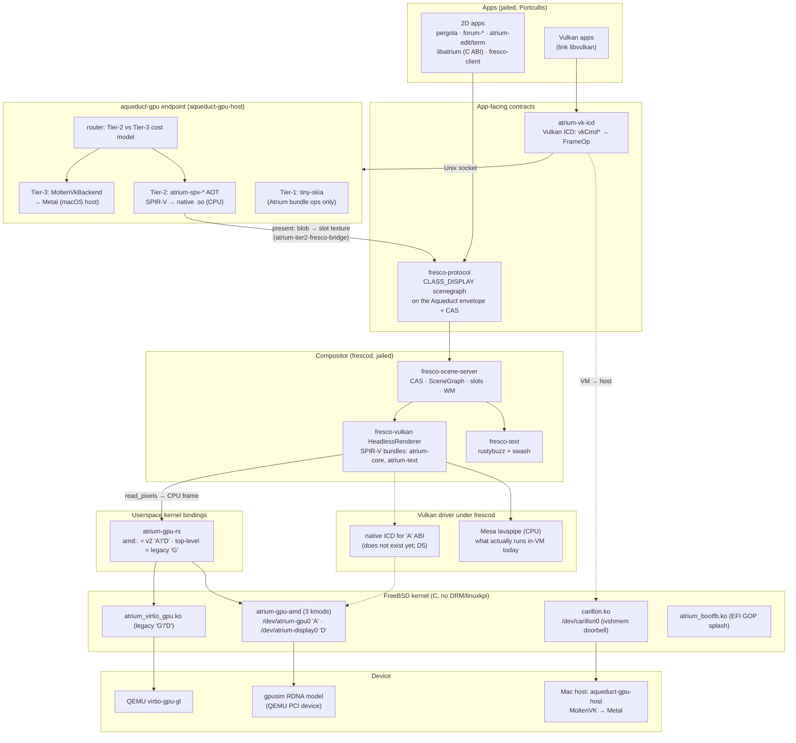

# The Atrium graphics stack, as built

> **What this is.** A map of the graphics stack as the code stands on
> 2026-11-03: kernel drivers, the ABIs above them, the dispatch protocol, the
> renderers, the compositor, and how a 2D app and a 3D app each reach the
> screen. Written from the code first, with the specs as secondary evidence.
> Where the two disagree, the code wins here, and §9 lists the disagreements.
>
> It's a snapshot, not a spec. For how things are meant to work, the
> specs are still the reference: `spec/gpu-abi-reconciliation.md` (which ABI
> is canonical), `spec/atrium-gpu-abi-v2.md`, `spec/atrium-display-architecture.md`,
> `spec/aqueduct-gpu.md`, `spec/carillon.md`, `spec/tier2-renderer.md`,
> `spec/fresco-rendering-stack.md`.

## 1. Summary

- **Apps never touch the GPU.** A 2D app sends a retained, content-addressed
  scenegraph (`fresco-protocol`, the `CLASS_DISPLAY` vocabulary on the
  Aqueduct envelope) to **frescod** over a Unix socket. frescod owns all GPU
  and display resources.
- **frescod renders with Vulkan** (`fresco-vulkan::HeadlessRenderer`, which
  runs SPIR-V "bundles" for rect/path/texture/glyph ops), reads the frame back
  to CPU memory, then hands it to the **native kernel driver** for scanout.
- **The kernel side is Atrium's own** (no DRM, no linuxkpi, no drm-kmod).
  The canonical driver is **`atrium-gpu-amd`**, a from-scratch RDNA4 driver
  that today runs against **gpusim**, a functional RDNA model in a separate
  repo, wired into QEMU as a PCI device. It exposes the v2 GPU ABI (`'A'`,
  `/dev/atrium-gpu0`) and the display ABI (`'D'`, `/dev/atrium-display0`).
- **No Vulkan driver for that kernel driver exists yet.** So inside the VM,
  frescod's Vulkan is the **CPU**: Mesa's **lavapipe**, from the FreeBSD
  package. The "GPU" in the native path does only the CP DMA copy of the
  finished frame into the VRAM scanout buffer.
- **3D and third-party Vulkan go through a separate GPU-dispatch protocol,
  `aqueduct-gpu`.** `atrium-vk-icd` turns Vulkan calls into `FrameOp`s and
  sends them to an `aqueduct-gpu-host` endpoint. That endpoint runs Tier-1
  (tiny-skia), Tier-2 (Atrium's own AOT SPIR-V→native CPU compiler,
  `atrium-spv-*`) or Tier-3 (MoltenVK→Metal on the Mac host, reached from the
  VM through the **Carillon** doorbell transport). The finished frames come
  back into frescod as textures.
- **Mesa: yes at runtime today, though not by design.** See §7.

## 2. Diagram



The canonical native frame path, step by step (frescod `main.rs`):

```
app ──fresco-protocol──▶ frescod: EnvelopeFrontend → SceneGraph/Compositor
                                   │ merge windows in z-order
                                   ▼
                         HeadlessRenderer (Vulkan: compute pass + indirect draw)
                                   │ on lavapipe = CPU
                                   ▼ read_pixels (BGRA8, CPU memory)
                         amd::Scanout::update_deadline
                                   │ System staging BO ─CP DMA_DATA─▶ VRAM scanout BO
                                   ▼ BO_EXPORT_SCANOUT → {vram_offset, size}
                         amd::Display::page_flip(vsync)   ─▶ gpusim DCN scans it out
                         pacing: thread::sleep at ~30 fps (not vblank kqueue)
```

## 3. Kernel layer

All native FreeBSD (newbus, cdev, bus_dma, kqueue, Capsicum). No DRM, GEM,
TTM, KMS or linuxkpi anywhere.

| Module | Source | Device | Surface | Status |
|---|---|---|---|---|
| `atrium_gpu_amd_pci.ko` + `atrium_gpu_amd.ko` + `atrium_gpu_amd_display.ko` | `atrium-gpu-amd/` (~6.7K LoC C) | gpusim (0x1002:0x7550) in QEMU via `run-vm.sh --gpusim`; real RDNA4 later | `/dev/atrium-gpu0` (`'A'`), `/dev/atrium-display0` (`'D'`) | **Canonical / reference.** M1–M9f done: firmware/MES bring-up, GPUVM, PM4 submit, MSI-X/IH, fd-as-handle BOs/VMs/syncobjs, `VM_BIND` into many VMs, opaque PM4-blob submit, doorbell user-mode queues, TLV caps, kqueue-able syncobjs, DCN display with EDID over DDC, vblank IRQ to kqueue, energy-budget member, reset, powergating. Front-end sits on an `atrium_gpu_backend_ops` vtable (gpusim backend today) |
| `atrium_virtio_gpu.ko` | `atrium-kmod/atrium_virtio_gpu.c` (~5.3K LoC) | QEMU `virtio-gpu-gl-pci` with blob + hostmem | `/dev/atrium-gpu0` (`'G'`), `/dev/atrium-display0` (`'D'` legacy) | **Legacy.** Integer-handle BOs, int fences, emulated vblank (callout), queued page-flip, venus `SUBMIT_3D`/`CTX_INIT`/`HOST_BLOB`, region tokens. Has an rc.d script. To be ported to `'A'` (reconciliation step 5, not started) |
| `carillon.ko` | `carillon-kmod/` | QEMU `ivshmem-doorbell` (`--carillon`) | `/dev/carillon0`: mmap BAR2 rings, `RING`/`WAIT` ioctls, MSI-X | Working. Byte transport for the aqueduct-gpu wire to the Mac host. Not a GPU driver |
| `fresco.ko` | `fresco-kmod/` | QEMU `ivshmem-doorbell` (`--gpu`) | `/dev/fresco0`, 1 ms polling callout | **Phase-0 relic.** Pairs with `libfresco` (C) and the out-of-repo `~/src/fresco` Metal server |
| `atrium_bootfb.ko` | `atrium-kmod/bootfb/` | EFI GOP framebuffer | mmap cdev | Boot splash (`atrium-splash`, tiny-skia). Exits when `/dev/atrium-display0` appears |
| `atrium_trace` | `atrium-kmod/atrium_trace_kmod.c` | — | trace ring | Shared tracing, linked into the virtio kmod |

Note: the amd modules include `<sys/energy_budget.h>`, so they build against
Atrium's patched `freebsd-src`, not stock FreeBSD.

### Kernel ABIs

| ABI | Header | Spec | Who implements | Who calls |
|---|---|---|---|---|
| **GPU v2, `'A'`** | `atrium-gpu-amd/atrium_gpu_amd_abi.h` | `atrium-gpu-abi-v2.md`, amended by `gpu-abi-reconciliation.md` | atrium-gpu-amd | `atrium-gpu-rs::amd`, frescod, the amd smokes |
| **Display, `'D'` (offset model)** | `atrium-gpu-amd/atrium_display_abi.h` | `atrium-display-architecture.md` | atrium-gpu-amd display kmod | `atrium-gpu-rs::amd::Display`, frescod |
| **Legacy GPU `'G'` + display `'D'`** | `atrium-kmod/atrium_gpu.h` | `gpu-abi.md` (v0.1, superseded) | atrium_virtio_gpu | `atrium-gpu-rs` top level, `frescod-aqueduct`, `aqueduct_smoke`, `carillon-guest/scanout.rs`, the C tests in `atrium-kmod/` |

Display ABI today is the "interim" shape: `SET_MODE`/`PAGE_FLIP` taking
`{vram_offset,size}`, a `STATUS` poll, and kqueue vblank on the display fd.
The target (atomic commit, syncobj in/out fences on flips, multi-connector) is
specified but not built.

## 4. Userspace bindings and the dispatch protocol

- **`atrium-gpu-rs`**: the Rust binding. `atrium_gpu::amd::{Gpu, Vm, Bo,
  Syncobj, Scanout, Display}` is the v2 surface (verified in-VM by
  `amd_smoke`, `bo_share`, `display_flip`, `vblank_kq`, …). The crate's
  top-level `Gpu`/`Display`/`Bo` are still the legacy `'G'` virtio surface.
  Both coexist in one crate.
- **`aqueduct`**: the envelope + CAS + class-registry IPC used everywhere
  (Unix sockets).
- **`aqueduct-gpu`**: a frame-batched GPU-dispatch protocol (`FrameOp`s:
  create image/buffer/pipeline, upload/resolve shader by SHA-256, begin render
  pass, draw, dispatch, present, plus host-split and TLAS ops). Clients:
  `aqueduct-gpu-client::GpuClient`. Both frescod-aqueduct and `atrium-vk-icd`
  speak it.
- **`aqueduct-gpu-host`**: the endpoint. A `Session` per connection, a
  resource table, a SPIR-V validator/annotator/cache (the "universal shader
  sandbox"), and a `Backend` trait:
  `Stub | Software (Tier-1) | Tier2 | MoltenVk (Tier-3) | Routing`.
  It's mostly built as a macOS daemon, but it's also a library linked
  in-process (frescod depends on it).
- **Transports for that wire**: a Unix socket (same OS) or **Carillon**
  (FreeBSD VM → Mac host: ivshmem shared rings, MSI-X doorbell guest-side,
  eventfd host-side, no polling). `carillon-transport` is the shared ring
  code; `carillon-guest` is the verified guest program that drives a full
  frame to Metal and back.

## 5. Renderers (the "tiers")

The tier model is in `fresco-rendering-stack.md` and
`gpu-abi-reconciliation.md` §8. Tiers apply to the **aqueduct-gpu endpoint**,
not to the kernel ABI.

| Tier | What | Code | Handles |
|---|---|---|---|
| Tier-1 | tiny-skia CPU raster | `aqueduct-gpu-host/src/software/` | Atrium's own bundle ops only (rect, path, textured rect, glyph run). Rejects third-party SPIR-V |
| Tier-2 | **AOT software Vulkan**: SPIR-V → `atrium-spv-ir` → bespoke ARM64/x86_64 backend (Cranelift fallback) → `.so`, dlopen'd. No JIT in the hot path; compile happens in a jailed sub-process | `atrium-spv-*` (11 crates), `aqueduct-gpu-host/src/tier2_*.rs` | Third-party SPIR-V: graphics D.1–D.8 (vertex input, depth/blend, indexed draws) plus compute |
| Tier-3 | Real GPU. Today: MoltenVK → Metal on the Mac host | `aqueduct-gpu-host/src/moltenvk.rs` (~5.8K LoC) | Everything, including ray tracing (see §8) |
| Router | Picks Tier-2 vs Tier-3 on a cost/energy model | `aqueduct-gpu-host/src/router.rs`, `cost_model.rs` | — |

There's a **separate renderer outside the tier model**, the one frescod
actually uses: `fresco-vulkan::HeadlessRenderer`. It loads SPIR-V bundles
(`bundles/atrium-core`: rect/texture/path, `bundles/atrium-text`: glyphs;
shaders written in Slang and built with `slangc`), runs one compute pass and
one indirect-instanced render pass per frame, and reads back. It's plain
Vulkan through the system loader, so its speed depends entirely on which ICD
is installed (§7).

## 6. How apps reach the screen

### 2D (every Atrium app today)

1. The app uses **Pergola** (the reactive toolkit, `taffy` layout) or calls
   `fresco-client` directly. C/other-language apps go through `libatrium`
   (Insula C ABI; display calls are planned, only init/log/exit exist).
2. `fresco-client` encodes `CLASS_DISPLAY` ops (windows, slots, rect/path/
   texture/glyph-run nodes, blobs by SHA-256) on an Aqueduct connection to
   frescod's socket. Text is shaped client- or server-side by `fresco-text`
   (rustybuzz + swash).
3. frescod (`fresco-scene-server`) keeps per-window scene state and the CAS
   store. `forum-wm` drives window management over a separate WM socket,
   with a cap check by peer uid.
4. frescod renders, reads back and scans out, as in §2.

### 3D / third-party Vulkan

1. The app links `libvulkan`. The loader finds `atrium_icd.json` →
   `libatrium_vk_icd.so`.
2. `atrium-vk-icd` connects to an aqueduct-gpu socket (`ATRIUM_VK_ICD_SOCKET`).
   If nothing's listening, it reports zero physical devices. It records
   `vkCmd*` into `FrameOp`s, flushed at `vkQueueSubmit`. Shaders are
   resolved by hash (cache hit) or uploaded and validated.
3. The endpoint executes on Tier-2 (in-VM, CPU) or Tier-3 (host GPU via
   Carillon).
4. On present, `atrium-tier2-fresco-bridge` uploads the pixels as a CAS blob,
   binds it to the window's slot texture, and calls `window_present`. **The
   3D app's output enters the compositor as a texture.** It's copied, not
   shared as a buffer, consistent with "apps never touch GPU memory."

### Run configurations that actually exist

| `run-vm.sh` profile | Kernel driver | Compositor binary | Vulkan under the compositor | Status |
|---|---|---|---|---|
| `--gpusim` | atrium-gpu-amd | `frescod` (main) | lavapipe | Canonical native path |
| (any) + `FRESCOD_HEADLESS_PNG` | none | `frescod` headless | lavapipe | Used for jailed-desktop end-to-end runs |
| `--virtio-gpu --display` | atrium_virtio_gpu | `frescod-aqueduct` (Tier-1 in-process, no Vulkan) | none | Legacy `'G'` |
| `--carillon` (+ `--virtio-gpu` to see pixels) | carillon.ko (+ atrium_virtio_gpu for display) | `carillon-guest` (test program) | host MoltenVK | Transport verified; no compositor on it |
| `--venus` | atrium_virtio_gpu | `frescod-vulkan-smoke` | atrium-mesa venus → MoltenVK | **Superseded** |
| `--gpu` | fresco.ko | out-of-repo `~/src/fresco` server | Metal on host | **Phase-0 relic** |

## 7. Is Mesa used?

The design says only at build time. At runtime it is used anyway:

- **At runtime: yes, lavapipe.** Every frescod path that renders pixels in the
  VM uses Mesa's **lavapipe** CPU Vulkan from the FreeBSD `mesa-devel`
  package. The evidence: RUNBOOK ("UI render pipe-clean … lavapipe"), the
  `HeadlessRenderer` device-pick comments, and `etc/jaild.policy.toml`, which
  mounts `/usr/local/share/vulkan` and `/usr/local/llvm19/lib` into frescod's
  jail specifically "for the lavapipe/radeon vulkan ICDs frescod loads." The
  RUNBOOK calls lavapipe "kept for comparison" with `atrium-vk-icd` "the
  eventual swap-in," but nothing in the tree runs frescod's HeadlessRenderer
  on `atrium-vk-icd` yet.
- **atrium-mesa fork: it exists, but only for venus, which is superseded.**
  `github.com/atrium-os/mesa` (cloned at `external/mesa`, built in-VM at
  `/root/mesa`) carries a venus ICD with a `vn_renderer_atrium.c` backend.
  It powered the V5–V7 milestones (first real Fresco frame on the M4 Max,
  May 2026). It went with venus when Carillon replaced it.
  `scripts/install-venus-icd.sh` and the `mesa_share` 9p mount in
  `run-vm.sh` are what's left of it.
- **The planned atrium-mesa (D5) isn't started.** The plan (Mesa pruned to
  NIR + radv/anv/nvk + vk_common, libdrm swapped for `'A'` ABI calls, run at
  install time or in trusted daemons, never per-app) has no code. Nothing in
  the Rust/C tree links Mesa. `aqueduct-gpu` reserves a "Mesa NIR" shader
  payload kind, and `aqueduct-gpu-host/src/session.rs` already lets NIR bypass
  validation as "trusted," so the slot is there.
- **Tier-2 replaced the llvmpipe/lavapipe plan** for third-party Vulkan, to keep
  Mesa out of runtime.

So the open question is what replaces lavapipe under frescod. There are two
candidates: (a) point `HeadlessRenderer` at `atrium-vk-icd` + Tier-2, which
is in-tree, CPU-only, and Atrium-owned, or (b) the native `'A'` Vulkan driver,
whether from-scratch or the atrium-mesa radv retarget. (b) is the only route
to real GPU rendering on the native path.

## 8. Recent aqueduct-gpu-host work that looks Orbis-driven

The last ~35 commits (late Sep → 2026-10-02) are in `aqueduct-gpu-host` /
`aqueduct`: TLAS/BLAS streaming and in-frame refits, `FrameOp::HostSplit`,
frames in flight, `VK_GOOGLE_display_timing`, MetalFX-based frame
interpolation with present pacing, `HostSync` (timeline semaphore exported as
`MTLSharedEvent`), native MSL kernels via MoltenVK, and a kernel-capture
tool. Their benchmarks cite the "Orbis street scene." It's real code in the
Tier-3 backend and Atrium can use it, but it doesn't advance the FreeBSD
native graphics path. It runs only on the Mac host through MoltenVK. Keep it
apart when judging Atrium progress.

## 9. Gaps and inconsistencies

Architecture gaps (things that block a real graphics stack):

1. **No Vulkan driver for the canonical kernel driver.** frescod renders on
   lavapipe (CPU) and uses atrium-gpu-amd only to DMA-copy the finished frame
   into VRAM. The GPU never renders the desktop. `tests/firstlight.c` shows
   the GPU can render a frame by direct PM4 dispatch, but no Vulkan or bundle
   path targets `'A'`.
2. **The compositor is split across two kernel ABIs.** `frescod` (main) is on
   `'A'`/`'D'` + Vulkan. `frescod-aqueduct` is on legacy `'G'` + Tier-1
   tiny-skia. It has the triple-buffering, vblank pacing, queued flips and the
   damage/skip hierarchy that main lacks. Those features exist only on the
   path that's being retired.
3. **frescod doesn't use the vblank it has.** atrium-gpu-amd delivers vblank
   over kqueue (D-3 resolved, `vblank_kq` verified), but frescod main still
   paces with `thread::sleep` at a fixed 30 fps. The flip has no syncobj
   in-fence, so nothing ties the flip to render completion beyond the
   synchronous readback.
4. **A full-frame CPU round-trip every frame.** Vulkan render → `read_pixels`
   → CPU buffer → staging BO → DMA → VRAM. This costs nothing extra on
   lavapipe, but it would throw away a real GPU's advantage.
5. **Carillon has no compositor on it.** The verified guest→Metal path is a
   test program (`carillon-guest`). `atrium-vk-icd` only speaks Unix sockets.
   No frescod mode sends its rendering over Carillon, and no glue lets an
   in-VM Vulkan app reach the host GPU. Its output also goes back through the
   legacy virtio `'G'` display.
6. **The legacy virtio display needs venus.** `atrium_virtio_gpu.c` creates its
   scanout context under the **venus capset** and fails `ENOTSUP` without it,
   and the attach requires blob + context-init. So "retired" venus is still a
   host-side dependency of the legacy display path (Carillon's display
   included).
7. **The `'A'` ABI isn't finished.** No `queue_fd` / `QUEUE_CREATE`, `SUBMIT`
   still takes ring_fd + n_dwords, no `BO_MMAP_INFO`, no cross-device
   `share_fd`, no `QUERY_TELEMETRY` (`SCHED`/`POWERGATE` stand in). The
   display has no atomic commit, flip fences or multi-connector support.
   v2's text was never amended to match the reconciliation decisions D-1/D-2.
8. **Both drivers create `/dev/atrium-gpu0` and `/dev/atrium-display0`**
   with incompatible ioctl groups. Loading both would collide. The legacy header
   also defines `WAIT_VBLANK` and `CURSOR` both as `'D',5` (they differ only
   by size).
9. **Jail policy contradicts itself.** `[services.frescod]` runs as
   `uid = "root"` ("owns /dev/atrium-gpu0"), while `atrium.devfs.rules` and
   the `_frescod` uid entry describe a non-root compositor.

Docs vs code:

10. **The README and ROADMAP still treat Mesa as the runtime plan.** `README.md`
    and `ROADMAP.md` list the atrium-mesa fork as the D5 dependency for
    production rendering. `fresco-rendering-stack.md` §0/§2 says "Mesa becomes
    our Vulkan implementation." `ARCHITECTURE.md` and `aqueduct-gpu.md` say
    "Mesa only at build time." Neither says lavapipe is what runs today.
11. **`docs/subsystems/graphics.md` is badly stale.** It describes `/dev/fresco0`
    + ivshmem as the protocol transport, a `GpuBackend` trait with
    `metal_backend`/`vulkan_backend`/`virtio_backend` (none exist), "Vulkan via
    linuxkpi-amdgpu," and `atrium-virtio-gpu` as the QEMU production target.
    Its "reference implementations" point at `fresco-server/src/...`, which
    isn't in this repo (it's now `fresco-scene-server/`).
12. **`tier2-renderer.md` says "Design v2. No code yet."** The 11 `atrium-spv-*`
    crates and `tier2_backend.rs` (~4.7K LoC) exist and are tested.
13. **`atrium-vk-icd/src/lib.rs` module docs say "Skeleton only"** while the
    README (correctly) says the 1.0–1.3 dispatch surface is complete (~190
    entry points).
14. **`aqueduct-gpu-host/README.md` calls MoltenVkBackend a "skeleton"**
    (it's ~5.8K LoC with ray tracing). It also omits Tier-2/Routing/Carillon.
15. **`atrium_virtio_gpu.c`'s header says "D0 skeleton, step 1, all ioctls
    EOPNOTSUPP."** `frescod/src/main.rs` says "no vblank events on virtio-gpu
    yet," but it's on amd and amd has vblank.
16. **The `run-vm.sh --virtio-gpu` comment conflates two transports.** It says
    Fresco/Forum render "through CARILLON — i.e. `--gpu` plus fresco-server
    (~/src/fresco) … /tmp/fresco-shmem.sock." That's the Phase-0 `fresco.ko`
    path. Carillon is `--carillon` + `aqueduct-gpu-host` on
    `/tmp/carillon.sock`.
17. **`fresco-production-rollout.md` says "not yet started"** in its header,
    while its log records M0–M3 + M2.7 landed. Its gate 1 ("lavapipe is the SW
    fallback") is the only place lavapipe is named as the intended fallback.
18. **`atrium-gpu-host-contract.md` presents the virtio `'G'` ABI** as "the
    stable userspace ABI." The reconciliation doc marks it legacy.
19. **`atrium-gpu-driver-architecture.md` §4** still describes the bring-up
    ABI (`SET_COMPUTE`/`SET_DRAW`, `WAIT_FENCE`) as current. §6 of the same
    file says those were deleted.

## 10. Where to start

These follow from §9, highest leverage first:

1. **Decide what replaces lavapipe under frescod** (§7). That decides
   whether the next big arc is Tier-2-under-frescod (small, in-tree) or the
   native `'A'` Vulkan driver (large).
2. **Make frescod main the only compositor.** Port frescod-aqueduct's
   triple-buffer, damage and skip logic onto the `'A'`/`'D'` path, pace on
   kqueue vblank, and retire `frescod-aqueduct`'s dependency on `'G'`.
3. **Finish `'A'`** (queue_fd submit, share_fd, telemetry) and the display
   target (atomic commit + flip fences). Then amend v2's text.
4. **Doc sweep**: rewrite `subsystems/graphics.md` from this file, fix the
   stale status headers in items 11–19, and update README/ROADMAP on Mesa.

## 11. Source map

| Area | Paths |
|---|---|
| Kernel | `atrium-gpu-amd/`, `atrium-kmod/`, `carillon-kmod/`, `fresco-kmod/`, `atrium-kmod/bootfb/` |
| Kernel bindings | `atrium-gpu-rs/` (`src/amd.rs` = v2), `atrium-bootfb-rs/` |
| IPC / dispatch | `aqueduct/`, `aqueduct-gpu/`, `aqueduct-gpu-client/`, `aqueduct-gpu-host/`, `carillon-transport/`, `carillon-guest/` |
| Software Vulkan | `atrium-spv-*` (frontend, ir, compile, backend-bespoke, backend-cranelift, loader, runtime, blob, pcmap, differential, tests) |
| Vulkan ICD | `atrium-vk-icd/` |
| Compositor | `frescod/` (bins: `frescod`, `frescod-aqueduct`, `frescod-vulkan-smoke`, `frescod-wm-harness`), `fresco-scene-server/`, `fresco-vulkan/`, `bundles/` |
| Bridges | `fresco-aqueduct-bridge/` (scene → FrameOps), `atrium-tier2-fresco-bridge/` (Tier-2 present → slot texture) |
| App side | `fresco-protocol/`, `fresco-client/`, `fresco-text/`, `pergola/`, `libatrium/`, `forum-*`, `libfresco/` (Phase-0) |
| Boot | `atrium-splash/` |
| Out of repo | gpusim (`~/src/gpusim`), `external/{mesa,MoltenVK,virglrenderer,qemu-build,slang-bin}`, `~/src/fresco` |
